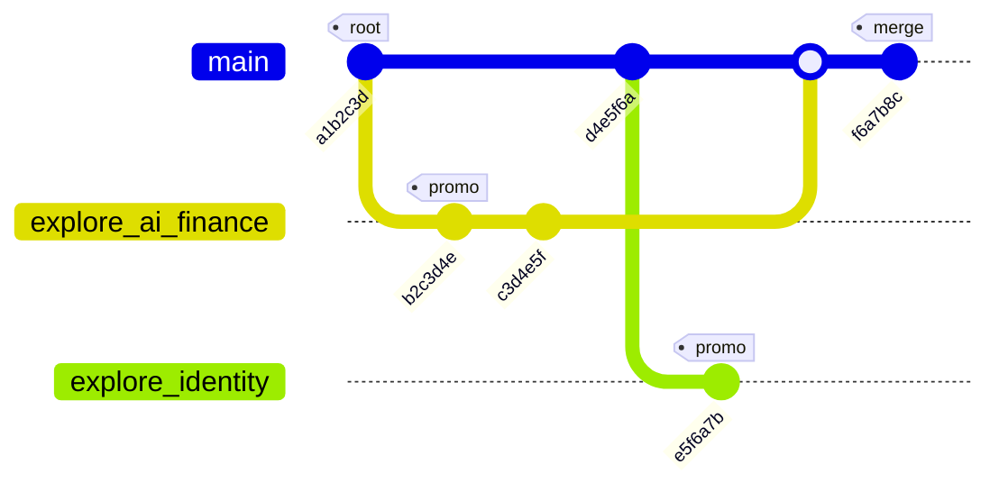

# Visualization Spec — Multiverse Console & gitGraph

## 0. Principle

> If the multiverse store is right, **diagrams are projections**, not a second database.

All UI reads from: `Branch`, `Checkpoint`, `MergeRecord`, `CompoundScenario`, `PromotionRecord`, `TelemetryEvent` rollups.

---

## 1. Mermaid `gitGraph` topology

### 1.1 Semantics mapping

| Multiverse concept | gitGraph element |
|--------------------|------------------|
| Branch | `branch` / colored line |
| Checkpoint | `commit` (station) |
| Promotion | commit with tag `promo` |
| Fork | `checkout` + `branch` |
| Merge | `merge` |
| Abandoned branch | branch with final commit message `ABANDON: reason` |
| Conflict (no merge) | two commits side-by-side; note in sidebar, **not** fake merge |

### 1.2 Generation algorithm

```text
Input: branch table + checkpoint DAG + merges
1. Order checkpoints by created_at within branch
2. Emit gitGraph TB (or LR for wide maps)
3. Mainline = branch with name "main" or earliest root
4. For each branch sorted by created_at:
     - checkout parent branch at fork checkpoint
     - branch <safe_id>
     - for each checkpoint: commit id:"<short_hash>" tag:"..."
5. For each MergeRecord with conflict=false:
     - merge child into target using Mermaid merge syntax
6. Cap: max C commits displayed; if exceeded, collapse internal non-promo
   commits into "… n commits …" synthetic node with link to full view
```

### 1.3 Commit labels

```text
id: first 7 of checkpoint_id
message: "c12 · +2 promo · $0.42"  (cycle summary)
tag: promo | fork | merge | abandon | eval
```

### 1.4 Color

Each `branch.color` → CSS class. Accessibility: also use dashed/dotted for abandoned.

### 1.5 Example projection (illustrative)



### 1.6 Failure modes

- Mermaid cannot render huge graphs → **must** collapse (see cap).
- Concurrent merges → deterministic sort by `merge_id`.
- Soft-equivalent non-merged branches look like parallel lines forever — correct; show “dup candidate” badge in console.

---

## 2. Live console

### 2.1 Layout (single page, no slideware)

```text
┌─────────────────────────────────────────────────────────────────────────┐
│ RUN run_id · elapsed · SPEND $x.xx (frontier y% · local z%) · cache h%   │
├───────────────────────────┬─────────────────────────────────────────────┤
│ ACTIVE BRANCHES           │  FRONTIER / ARCHIVE                         │
│ · name  head  $  promos   │  Top candidates by U (live)                 │
│ · …                       │  Promoted this run                          │
├───────────────────────────┴─────────────────────────────────────────────┤
│ gitGraph (selected branches)                                            │
├─────────────────────────────────────────────────────────────────────────┤
│ EVENT TICKER (SSE): cycle, promo, merge, egress_deny, eval              │
├─────────────────────────────────────────────────────────────────────────┤
│ PHASE SPEND BAR: generation | evaluation | merge | eval_harness         │
└─────────────────────────────────────────────────────────────────────────┘
```

### 2.2 Refresh

- SSE or WebSocket from control plane every 1–2s with **rollups**, not raw token spam.
- Client requests full gitGraph only on branch topology change (version counter).

### 2.3 Controls

- Pause / resume run  
- Kill branch  
- Force checkpoint  
- Open scenario detail  

---

## 3. Scenario detail view

| Section | Source fields |
|---------|----------------|
| Header | title, scenario_id, status, branch, state_hash short |
| Members | risk_ids → RiskAtom titles, channels |
| Score decomposition | ScoreRealization.components tree |
| Uncertainty | class, intervals, disagreement |
| Evidence chain | feature ids, scoring-cell ids (aggregate codes only in UI roles) |
| Provenance | models, algorithm_version, seeds |
| Ancestry | parent_ids path to root (mini gitGraph or breadcrumb) |
| Telemetry | attributed cost for this scenario |
| Actions | promote/reject (if human gate), fork with assumption edit |

**RBAC:** aggregate values only for authorized roles; demo mode uses synthetic.

---

## 4. Data contract (API)

### 4.1 `GET /api/run/{run_id}/summary`

```json
{
  "run_id": "…",
  "status": "running",
  "spend_usd": 1.23,
  "spend_by_phase": {"generation": 0.4, "evaluation": 0.7, "merge": 0.1, "eval_harness": 0.03},
  "tokens": {"input": 0, "output": 0, "cache_read": 0, "cache_write": 0},
  "cache_hit_rate": 0.0,
  "n_active_branches": 3,
  "n_promoted": 2,
  "cost_per_promoted_usd": 0.615,
  "topology_version": 14
}
```

### 4.2 `GET /api/run/{run_id}/topology?max_commits=80`

```json
{
  "topology_version": 14,
  "branches": [
    {"branch_id": "main", "name": "main", "color": "#6b7280", "status": "active", "head": "…"}
  ],
  "checkpoints": [
    {
      "checkpoint_id": "…",
      "branch_id": "main",
      "parent_checkpoint_id": null,
      "short": "a1b2c3d",
      "tags": ["root"],
      "label": "c0 · $0.00",
      "created_at": "…"
    }
  ],
  "merges": [
    {"merge_id": "…", "parents": ["…", "…"], "child": "…", "conflict": false}
  ],
  "mermaid": "gitGraph\n  commit id: \"a1b2c3d\"\n  …"
}
```

Server may pre-render `mermaid` string; client can also build from nodes.

### 4.3 `GET /api/scenarios/{id}`

Full detail payload per §3.

### 4.4 `GET /api/run/{run_id}/events` (SSE)

```text
event: rollup
data: { "spend_usd": 1.24, "n_promoted": 2, ... }

event: promo
data: { "scenario_id": "…", "U_score": 0.71 }

event: egress_deny
data: { "node": "score_jdg", "reason": "s2_field" }
```

---

## 5. Implementation notes

| Piece | **(REC)** Phase 1 |
|-------|-------------------|
| Console | Extend existing static dashboard **or** single new page; avoid full rewrite |
| Mermaid | Render client-side via mermaid.js |
| Auth | Localhost-only Phase 1 |
| Performance | Pre-aggregate telemetry; never ship full JSONL to browser |

---

## 6. Acceptance tests

1. Creating a fork in the store changes `topology_version` and adds a branch line.
2. MergeRecord with conflict=true does **not** emit Mermaid `merge`.
3. Summary spend matches telemetry sum ± $0.001.
4. Scenario detail shows ancestry length ≥ 1 for non-roots.

---

## 7. Open questions

1. Embed console in existing `contingency_atlas.web` — **(REC)** yes, new route `/multiverse`.
2. 3D viz — **out of scope**.
