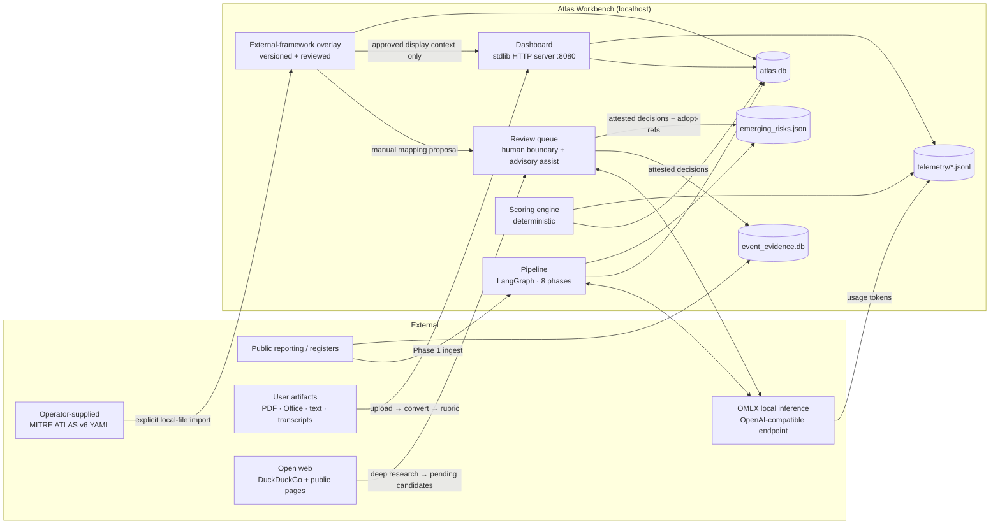

# Architecture

## 1. Purpose and non-goals

Atlas Workbench is an operational-risk foresight and scenario-analysis
system. It (a) ingests public evidence and artifacts into a structured
store, (b) monitors emerging risks, (c) generates and prioritizes
scenarios, and (d) monthly joins the risk catalog into **compound
scenarios** — pairs of emerging risks scored for co-materialization with
an auditable hybrid engine.

**Non-goals (explicit):**

- Not a capital model, AMA/SMA replacement, or ICAAP calculator.
- Not a predictor of next quarter's losses.
- Not a replacement for human scenario workshops — it multiplies the
  candidates those workshops can challenge.
- Not an autonomous publisher: external content is transformed into
  structured records only through review-gated paths.

## 2. System context

Trust boundaries: (1) public internet content enters only through
provenance-reviewed channels; (2) the OMLX endpoint is local inference
(no frontier calls in the current deployment); (3) the egress gateway
governs anything that would leave for external models (ADR-002).

## 3. Components

| Component | Location | Responsibility |
|-----------|----------|----------------|
| **Pipeline** | `workbench_atlas/pipeline.py`, `phases/` | Eight LangGraph nodes: ingest evidence → risk monitor → generate scenarios → prioritize → patterns → maintain → compound join → graduate |
| **Scoring engine** | `workbench_atlas/scoring/` | Deterministic hybrid F×S + dependence + MC + EVT; pair candidates; evaluation harness (incl. `task_bcal.py` levels, `task_loss.py` severities, multiseed + bootstrap CIs); calibration; external feature screen |
| **Judgment ledger** | `workbench_atlas/scoring/judgment_ledger.py` | Hash-chained claim ledger (`generated/judgment/ledger.jsonl`): frozen forecasts → quarterly resolution → Brier over resolved claims |
| **Elicitation** | `workbench_atlas/scoring/elicitation.py` | OMLX channel audit + analogue elicitation + contamination canary; output is proposals only |
| **Compound join** | `workbench_atlas/compound_join.py` | Monthly batch step: channel-blocked pair scoring into `compound_scenarios` |
| **Compound graduation** | `workbench_atlas/compound_graduate.py` | Deterministic eligibility → LLM-drafted document → QA judge → library insert |
| **Artifact ingestion** | `workbench_atlas/ingest_artifacts.py` | Upload → markdown (MarkItDown optional) → bounded chunk-map extraction → rubric check → review-first prefill |
| **Review workflow** | `workbench_atlas/review.py` | The human boundary: attestation-gated approvals, non-raising validation reports, cross-process register lock |
| **Advisory pre-analysis** | `workbench_atlas/review_assist.py` | Judge-model pre-analysis of pending records — verdict-style for events/risks, explanation-only (no recommendation) for channel proposals; content-hashed suggestion cache; suggestion-vs-decision agreement audit (ADR-013) |
| **Deep research** | `workbench_atlas/research.py` | Bounded DDG search + capped public-page fetches (PDFs parsed locally with pypdf) → pending evidence candidates + coverage memo; gated channel-proposal mode files no candidates and drafts the reviewer's reason; proposal-only (ADR-013) |
| **Proposal queues** | `workbench_atlas/proposals.py` | Merge / channel / analogue proposal stores; decided in `review.py` (reviewer + reason); never auto-applied (ADR-014) |
| **External-framework overlay** | `workbench_atlas/frameworks/` | Local-file MITRE ATLAS catalog import, release pinning, relationship lookup, and manual scenario-mapping proposals; approved context is display-only and non-scoring (ADR-016) |
| **Dedup scan** | `workbench_atlas/dedup.py` | Token-Jaccard `candidate_duplicates` ranker; `apply_merge` under the register lock (ADR-014) |
| **Refutation memos** | `workbench_atlas/refutations.py` | Display-only devil's-advocate memos; `definition_stress` windowed re-score; spot-audit report |
| **LLM client** | `workbench_atlas/llm.py` | OpenAI-compatible client; the telemetry choke point (ADR-007) |
| **Dashboard** | `workbench_atlas/web/` | stdlib HTTP server, loopback-only; seven-item command deck organized as Briefing → Research → Review → Analyze → Scenarios, with Settings and Method & Help utilities. Specialist surfaces are contextual tabs: Research holds Evidence, Signals & Radar, and Findings; Analyze holds Run cycle, Validation, and Telemetry; Scenarios holds Library and Compound candidates. |
| **Egress gateway** | `workbench_atlas/scoring/egress.py` | Allow-list validation + deny scans + hash-chained audit log |
| **Telemetry** | `workbench_atlas/scoring/telemetry.py` | Event model, pricing, run reports, production sink |
| **Stores** | `atlas.db`, `event_evidence.db`, `emerging_risks.json`, `generated/telemetry/*.jsonl`, `generated/judgment/ledger.jsonl` | SQLite + JSON/JSONL (ADR-009); atlas.db holds the `compound_scenarios` current view over the append-only `score_realizations` history, proposal queues, refutation memos, and optional versioned external-framework catalog and mapping decisions |

## 4. The eight phases

| # | Name | Cadence | LLM | What it does |
|---|------|---------|-----|--------------|
| 1 | Ingest Evidence | daily | required | Structured evidence events from reviewed text/artifacts |
| 2 | Risk Monitor | weekly | required | Identify/assess emerging risks into the catalog |
| 3 | Generate Scenarios | monthly | required | Risks + evidence → scenarios; QA judge gate ≥ 0.75 |
| 4 | Prioritize Scenarios | quarterly | offline | Likelihood × impact × controllability → urgency 0–100 |
| 5 | Loss Patterns | monthly | offline | Temporal causality (permutation), thematic lift |
| 6 | Maintain Library | quarterly | offline | Stale flags, gated merges/retirements |
| 7 | Compound Join | monthly | offline | Batch-score channel-blocked risk pairs into `compound_scenarios` |
| 8 | Graduate | monthly | required | Proven compounds → full library scenarios (LLM document + judge) |

Phases 7–8 are the redesign engine's production path; 1–6 are the
original pipeline. The monthly cadence of 7 is enforced by a 28-day due
gate (see ADR-004); phase 8 runs when eligible compounds exist.

Two additional job types run through the same background runner but
are **not** pipeline nodes: `review_analyze` (advisory pre-analysis of
the review queue) and `review_research` (bounded deep research for one
pending record). Both are proposal-only (ADR-013) and documented in
[review-and-research.md](review-and-research.md).

The human step between intake and synthesis is structural: phases 1–2
write `pending` records, phases 3/5/6 and the compound bridge consume
**approved-only** records (including the signal-activation series in
`scoring/r1.py`), and the Review queue is where the transition happens.
A full pipeline run is therefore intake *plus* re-synthesis of the
previously approved corpus — new material shapes results only after
review ("run → review → run").

## 5. Data planes and confidentiality

Three data classes govern placement (see `security.md`):

| Class | Examples | Allowed compute |
|-------|----------|-----------------|
| `public` | public evidence, public macro, taxonomies | any |
| `aggregate` | synthetic scoring-cell counts, severity quantiles, segment codes | local by default; may cross the egress gateway under allow-list |
| `local_detail` | synthetic event rows and red-team prose | local only; **never** to external APIs |

The egress gateway (`scoring/egress.py`) is the only sanctioned path
out: allow-list schemas, deny scans (free-text keys, email-like,
account-like, overlong prose), and a hash-chained audit log. In the
current deployment all inference is local OMLX, so the gateway's role is
defense-in-depth plus red-team-tested readiness for frontier use.

## 6. Technology choices (summary — rationale in ADRs)

| Concern | Choice | ADR |
|---------|--------|-----|
| Orchestration | LangGraph state graph | — (pre-existing) |
| Scoring core | Deterministic stdlib Python; no LLM in score path | ADR-001 |
| Statistics | Pure stdlib (no numpy/scipy) | ADR-010 |
| Storage | SQLite + JSON/JSONL | ADR-009 |
| Compound production path | Batch pair scoring (multiverse loop removed) | ADR-003 |
| Graduation | Deterministic eligibility; LLM prose only | ADR-005 |
| Artifact input | Review-first with rubric check | ADR-006 |
| LLM telemetry | Choke-point client instrumentation | ADR-007 |
| Web | stdlib server, no framework | ADR-008 |
| Validation exposure | One-off gate; no validation GUI page | ADR-011 |
| Runtime artifacts | Gitignored, regenerated | ADR-012 |
| Review assistance | Advisory-only, proposal-only, agreement-audited | ADR-013 |
| Register merges & proposal queues | Reviewer-decided, register-locked, never auto-applied | ADR-014 |
| MITRE ATLAS integration | Versioned, reviewed, display-only external overlay | ADR-016 |

## 7. Diagram

See [architecture-current.svg](architecture-current.svg) for the
component/plane diagram (also embedded above in mermaid form).
