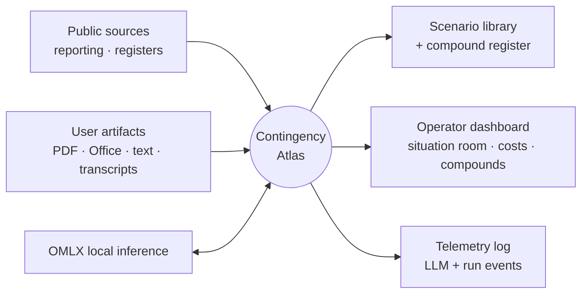
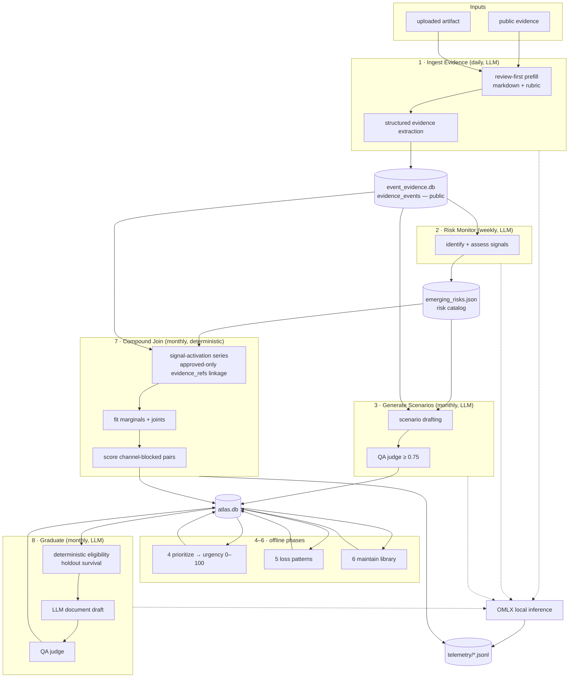
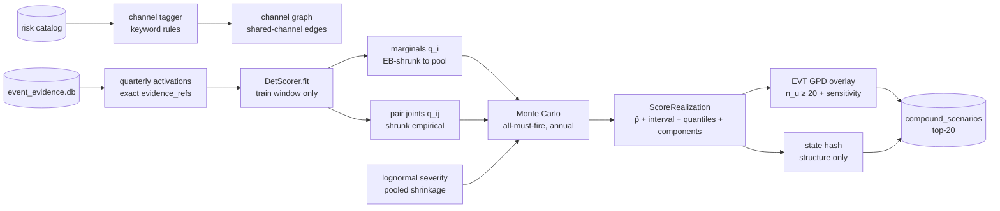
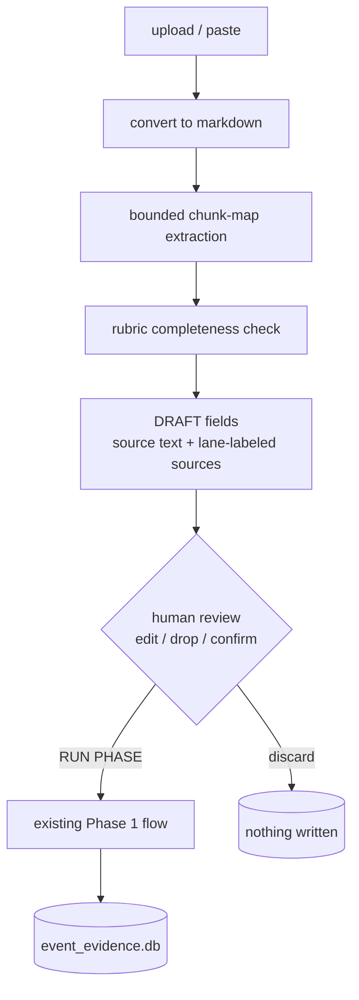
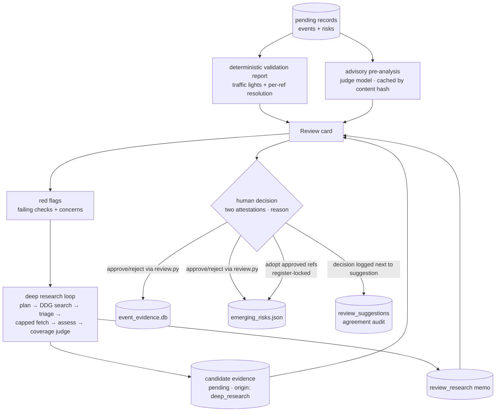

# Data Flow Diagrams

## 0. Context level (DFD-0)



## 1. Pipeline decomposition (DFD-1)



## 2. Compound scoring data flow (DFD-2)



## 3. Review boundary (all writes)



**Invariant:** no artifact ingestion path writes to a store without a
human-confirmed step. The conversion endpoint (`/api/ingest/convert`)
is read-only by construction.

## 3b. Review queue & deep research (DFD-3b)



**Invariants:** the pre-analysis and the research loop write only to
their advisory stores and to `pending` evidence; the four decision
functions in `review.py` are the only path to `approved`/`rejected`;
the research loop can only fetch URLs its own search returned, and
every fetch hop must be a public HTTP(S) URL (ADR-013).

## 4. Telemetry flow

```mermaid
flowchart LR
    subgraph Callers["LLM call sites"]
        P1[phases 1–3, 6]
        P8[phase 8 draft + judge]
        ING[ingest extract + rubric]
        EXT[external-feature null pass]
    end
    CHOKE[OMLXClient<br/>telemetry choke point]
    SINK[(generated/telemetry/<br/>llm.jsonl)]
    DET[deterministic jobs<br/>score_det events]
    JOINLOG[(compound-join.jsonl)]
    COSTS[/api/costs/summary]
    TOK[/api/tokens/usage]
    PAGE[Costs page +<br/>situation-room chart]

    Callers --> CHOKE --> SINK
    DET --> JOINLOG
    SINK --> COSTS
    JOINLOG --> COSTS
    SINK --> TOK
    JOINLOG --> TOK
    COSTS --> PAGE
    TOK --> PAGE
```
