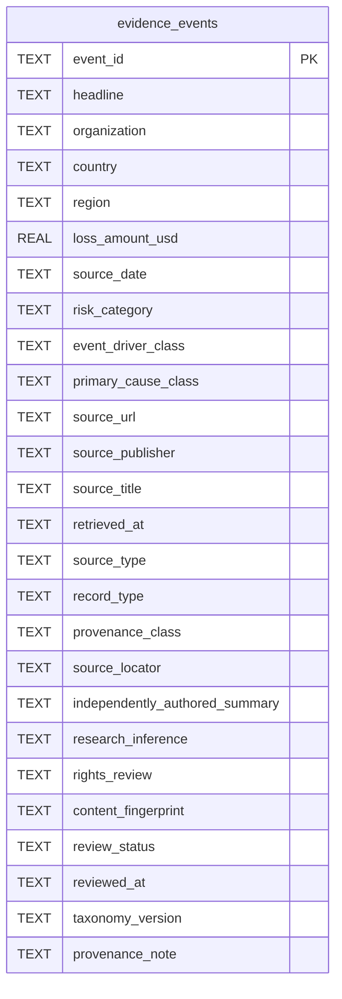
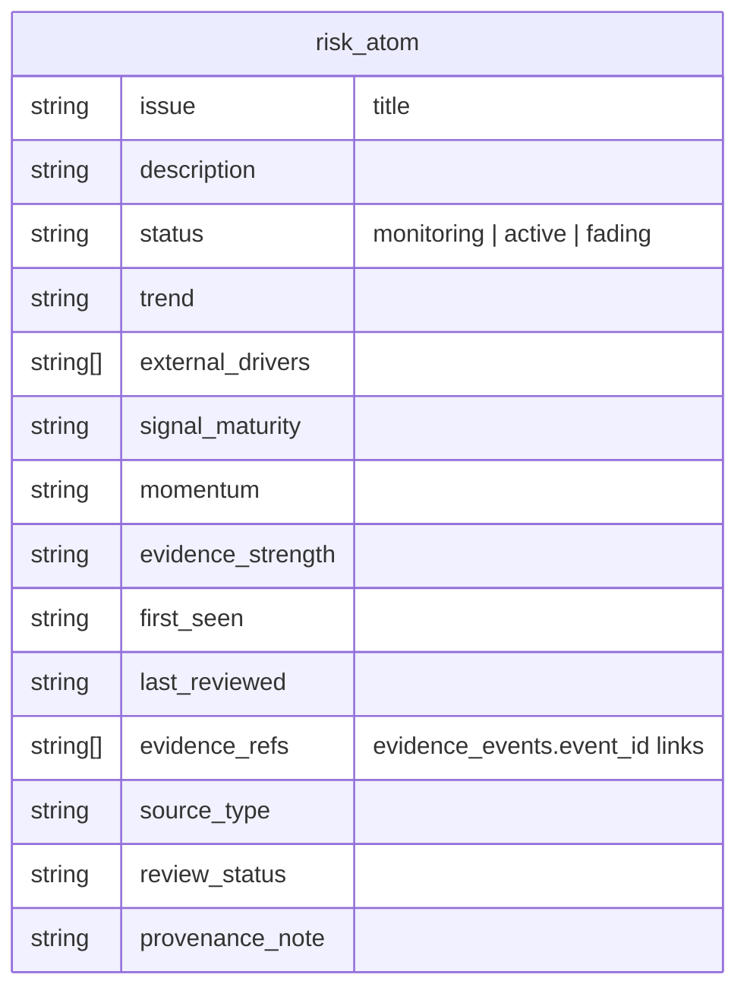
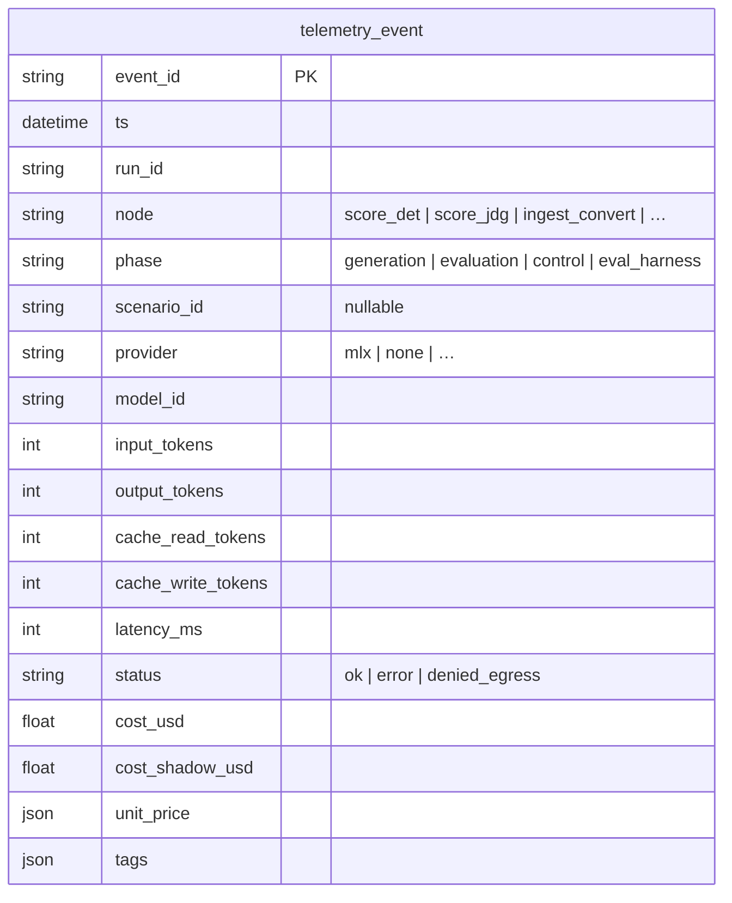

# Entity-Relationship Model

All persistent state is SQLite + JSON/JSONL files. There is no server
database; every store is a local file. Runtime artifacts
(`emerging_risks.json`, `compound_scenarios.json`, `generated/`) are
gitignored and regenerated (ADR-012).

## 1. atlas.db — scenarios and ledgers

```mermaid
erDiagram
    scenarios ||--o{ qa_logs : "judged in"
    scenarios ||--o{ signpost_assessments : "tracked by"
    compound_scenarios ||--o| compound_graduations : "graduates to"
    compound_join_runs ||--o{ compound_scenarios : "produced"
    compound_join_runs ||--o{ score_realizations : "appends"
    compound_scenarios ||--o{ analogues : "dossiers (pair_id)"
    compound_scenarios ||--o{ refutation_memos : "challenged by"
    framework_releases ||--o{ framework_objects : "contains"
    framework_releases ||--o{ framework_relationships : "contains"
    framework_releases ||--o{ framework_mapping_proposals : "pins"
    framework_objects ||--o{ framework_relationships : "source / target"
    framework_objects ||--o{ framework_mapping_proposals : "technique"
    scenarios ||--o{ framework_mapping_proposals : "reviewed against"
    scenario_mapping_revisions ||--o| scenarios : "tracks current generation"
    scenario_mapping_revisions ||--o{ framework_mapping_proposals : "versions claims"

    scenarios {
        TEXT scenario_id PK
        TEXT origin "operator_authored | pipeline_generated | compound_graduation | synthetic_fixture | legacy_unknown"
        TEXT title
        TEXT description
        TEXT risk_category
        TEXT status
        REAL urgency_score
        REAL judge_score
        TEXT judge_feedback
        TEXT core_risks
        TEXT likelihood
        TEXT financial_impact_band
        TEXT theme_tags
        TEXT additional_information
        TEXT transmission_mechanism
        TEXT defensive_options
        TEXT signal_maturity
        TEXT momentum
        TEXT evidence_strength
        INTEGER created_year
        INTEGER scenario_revision "mapping add-on; monotonic"
    }
    qa_logs {
        INTEGER id PK
        TEXT scenario_id FK
        TEXT phase
        TEXT judge_model
        REAL judge_score
        TEXT judge_feedback
        INTEGER iterations
        BOOLEAN passed
        TEXT timestamp
    }
    signpost_assessments {
        INTEGER id PK
        TEXT scenario_id FK
        TEXT classification
        TEXT rationale
        TEXT evidence_refs
        TEXT considered_refs
        TEXT evaluated_at
        TEXT review_status
        TEXT origin
    }
    framework_releases {
        TEXT framework PK "with content_version"
        TEXT content_version PK
        TEXT format_version
        TEXT release_date
        TEXT source_url
        TEXT source_sha256
        TEXT imported_at
        INTEGER is_active "one active release per framework"
        INTEGER is_sealed "snapshot rejects later appends"
    }
    framework_objects {
        TEXT framework PK,FK "with version and object_id"
        TEXT content_version PK,FK
        TEXT object_id PK "AML.TA / T / M / CS"
        TEXT object_type "tactic | technique | mitigation | case-study"
        TEXT name
        TEXT description
        TEXT maturity
        TEXT platforms_json
        TEXT object_hash
        TEXT payload_json "canonical upstream object"
    }
    framework_relationships {
        TEXT framework PK,FK "with version and key"
        TEXT content_version PK,FK
        TEXT relationship_key PK
        TEXT source_id FK
        TEXT relationship_type "sequences | achieves | specializes | mitigates | employs"
        TEXT target_id FK
        TEXT metadata_json
    }
    framework_mapping_proposals {
        TEXT proposal_id PK
        TEXT scenario_id FK
        TEXT scenario_hash "meaning-bearing snapshot hash"
        INTEGER scenario_revision "monotonic snapshot generation"
        TEXT framework FK
        TEXT content_version FK
        TEXT technique_id FK
        TEXT applicability "hypothesized"
        TEXT rationale
        TEXT evidence_refs_json
        TEXT origin "manual"
        TEXT status "pending | approved | rejected"
        TEXT reviewer
        TEXT reason
        TEXT decided_at
        TEXT created_at
    }
    scenario_mapping_revisions {
        TEXT scenario_id PK "survives scenario deletion"
        INTEGER revision "increments on insert, edit, or delete"
        TEXT changed_at
    }
    pipeline_runs {
        INTEGER id PK
        TEXT run_id UK
        TEXT phase
        TEXT status
        TEXT started_at
        TEXT completed_at
        INTEGER items_processed
        TEXT errors
        TEXT driftlab_cycle_id
        INTEGER driftlab_score
    }
    pattern_detections {
        INTEGER id PK
        TEXT pattern_type
        TEXT description
        REAL confidence
        TEXT evidence
        TEXT source_ids
        TEXT detected_at
        TEXT status
    }
    causal_findings {
        INTEGER id PK
        TEXT cause_event
        TEXT effect_event
        INTEGER lag_days
        REAL confidence
        INTEGER sample_count
        INTEGER counterexamples
        TEXT mechanism
        TEXT detected_at
    }
    compound_scenarios {
        TEXT compound_id PK "scn-<state_hash[:12]>"
        TEXT pair_id "pair-<sha256(sorted risk_ids)[:12]>"
        TEXT risk_ids "JSON array, sorted"
        TEXT state_hash
        TEXT data_hash "fitted series + train bounds"
        REAL p_hat
        REAL p_lo
        REAL p_hi
        REAL loss_q50 "NULL on activation regimes"
        REAL loss_q95
        REAL loss_mean
        TEXT loss_units "dollars | activation"
        TEXT uncertainty_class
        INTEGER dependence_support
        REAL evidence_support
        TEXT data_regime
        TEXT status
        TEXT run_id FK
        TEXT scored_at
        TEXT algorithm_version
        TEXT provenance_note
    }
    score_realizations {
        TEXT realization_id PK "sha256(state|data|judgment|seed|version)[:16]"
        TEXT run_id FK
        TEXT pair_id
        TEXT compound_id
        TEXT state_hash
        TEXT data_hash
        TEXT judgment_version "det"
        TEXT algorithm_version
        TEXT model_config_hash
        TEXT rng_seed
        REAL p_hat
        REAL p_lo
        REAL p_hi
        TEXT scored_at
        TEXT realization_json "full audit blob"
    }
    compound_join_runs {
        TEXT run_id PK
        TEXT started_at
        TEXT finished_at
        TEXT status "ok | insufficient_data | error"
        INTEGER n_risks
        INTEGER n_pairs
        INTEGER n_scored
        INTEGER n_written
        TEXT note
    }
    compound_graduations {
        TEXT compound_id PK
        TEXT scenario_id FK "ATLAS-CMP-*"
        TEXT run_id
        TEXT created_at
        TEXT eligibility "JSON"
        REAL judge_score
    }
    review_suggestions {
        INTEGER id PK
        TEXT record_kind "event | risk"
        TEXT record_id
        TEXT content_hash "sha256 of analyzed fields"
        TEXT model_id
        TEXT created_at
        TEXT recommendation "approve | reject | needs_more_evidence"
        REAL confidence
        TEXT payload "JSON: full advisory analysis"
        TEXT human_action "filled on decision — agreement audit"
        TEXT decided_at
    }
    review_research {
        INTEGER id PK
        TEXT record_kind
        TEXT record_id
        TEXT created_at
        TEXT model_id
        TEXT payload "JSON: verdict, coverage, findings, candidates"
    }
    merge_proposals {
        TEXT proposal_id PK
        TEXT risk_id_a
        TEXT risk_id_b
        REAL similarity "token-Jaccard"
        TEXT components "JSON: ranker detail"
        TEXT advisory
        TEXT status "pending | approved | rejected"
        TEXT reviewer
        TEXT reason
        TEXT decided_at
        TEXT merge_diff
    }
    channel_proposals {
        TEXT proposal_id PK
        TEXT kind "tag_add | edge_add | new_channel"
        TEXT risk_ids "JSON array"
        TEXT channel
        TEXT mechanism
        TEXT citation_url "URL-clamped at intake"
        TEXT citation_status
        TEXT status "auto_rejected never reaches pending"
        TEXT reviewer
        TEXT reason
        TEXT graph_version_applied "always NULL — never applied"
    }
    analogues {
        TEXT analogue_id PK
        TEXT pair_id FK
        TEXT risk_ids "JSON array"
        TEXT event
        TEXT period
        TEXT mechanism_map
        INTEGER co_fired
        TEXT outcome_class
        TEXT citations "JSON"
        TEXT disanalogies "mandatory"
        TEXT status "pending | approved | rejected"
        TEXT reviewer
        TEXT reason
    }
    refutation_memos {
        TEXT memo_id PK
        TEXT compound_id FK
        TEXT pair_id
        TEXT memo_json "display-only devil's advocate"
        TEXT model_id
        TEXT prompt_hash
        TEXT definition_stress_json "windowed re-score diagnostic"
        REAL reviewer_rating
        TEXT created_at
    }
```



Notes:

- `scenarios.origin` is required provenance. Direct writes default to
  `operator_authored`; pipeline generation, compound graduation, and bundled
  demo fixtures set their corresponding explicit values. Additive migration
  assigns `legacy_unknown` to historical rows whose source cannot be inferred.
  Consumers must branch on this field, never on scenario-ID prefixes.
- `compound_graduations` is created on first graduation run (additive,
  idempotent migration in `compound_graduate.migrate_graduations`).
- `scenarios` is the legacy register; **compound scores never map onto
  `urgency_score`** (ADR-004). Graduated compounds are inserted here
  with `ATLAS-CMP-*` ids and origin provenance in
  `additional_information`.
- `signpost_assessments` snapshot columns are immutable by trigger.
- `framework_releases`, `framework_objects`, and
  `framework_relationships` are a versioned local projection of an explicitly
  imported external catalog. A source file is identified by its exact-byte
  SHA-256. A successful release is sealed before activation, so later object
  and relationship appends are rejected; importing or activating a release
  never deletes an older release.
- `scenario_mapping_revisions` is a monotonic registry that survives scenario
  deletion. Triggers increment it on insert, meaning-bearing update, and
  delete, while `scenarios.scenario_revision` exposes the current generation.
- `framework_mapping_proposals` pins a scenario snapshot and technique to one
  imported release. Claim fields are append-oriented; only decision fields
  change at review. Approved mappings are display-only; stale approvals remain
  visible as audit context but are not treated as current when either the
  scenario hash or revision changes. Restoring identical text or deleting and
  recreating the same ID cannot reactivate an old approval. Mapping context
  joins the pinned release for source URL, source SHA-256, and relationship
  data; mappings never update scenario or scoring columns (ADR-016).
- `review_suggestions` and `review_research` are advisory stores
  (ADR-013): they never gate anything, are unique per
  `(kind, record, content_hash, model)` (suggestions) and append-only
  per run (research memos), and the `human_action` column turns the
  suggestion table into a suggestion-vs-decision agreement audit.
- `score_realizations` is the append-only score history (A7):
  no-update/no-delete triggers, idempotent on `realization_id`.
  `compound_scenarios` stays the current view (INSERT OR REPLACE) and
  gained `pair_id` / `data_hash` / `loss_units` by additive migration
  (pair_id backfilled on pre-existing rows).
- The proposal queues (`merge_proposals`, `channel_proposals`,
  `analogues`) follow the ADR-013 decision pattern (reviewer + reason),
  ratified for register merges by ADR-014: nothing self-applies —
  `graph_version_applied` is always NULL, auto-rejected channel
  proposals never reach pending, and analogue claims are append-only
  with mandatory disanalogies.
- `refutation_memos` are display-only devil's-advocate records
  (Compound Graduate modal opt-in); `definition_stress_json` holds the
  windowed re-score diagnostic. They never change scores.

## 2. event_evidence.db — public evidence events



Public only. Every row carries provenance (`source_url`,
`provenance_class`, `review_status`, `rights_review`,
`content_fingerprint`, `independently_authored_summary`) — nothing
enters without a canonical URL through a review-gated path. Two intake
lanes exist: the Phase 1 ingestion path and deep-research candidates
(`event_id = EVT-DR-<fingerprint[:12]>`, provenance note starting
`origin: deep_research`) — both land `pending` and go through the same
attested approval. The fingerprint recipe is shared: SHA-256 over
`source_url + publisher + title + date + summary`.

## 3. emerging_risks.json — risk catalog (runtime artifact)



Runtime artifact (gitignored), rewritten by Phase 2. `evidence_refs`
are exact `evidence_events.event_id` links — the only sanctioned join into the
signal-activation series (no fuzzy matching), and that series is
**approved-only on both sides**: `scoring/r1.py` filters evidence-event rows to
`approved`/`approved_synthetic` and drops risk records that have not
completed human review, so the compound bridge can only ever be driven
by reviewed data. Three writers mutate this file — the review workflow
(CLI and dashboard), Phase 2's monitoring cycle, and adopt-refs — all
serialized by an `flock` on the gitignored sidecar
`emerging_risks.json.lock` (see review-and-research.md §4).

## 4. compound_scenarios.json — monthly artifact

```json
{
  "run_id": "compound-…",
  "scored_at": "…",
  "algorithm_version": "0.2.0",
  "data_regime": "R1",
  "loss_units": "dollars",
  "compounds": [
    {
      "compound_id": "scn-…",
      "pair_id": "pair-…",
      "risk_ids": ["…", "…"],
      "p_hat": 0.0,
      "p_interval": [0.0, 0.0],
      "loss_quantiles": {"0.5": 0, "0.9": 0, "0.95": 0, "0.99": 0},
      "loss_units": "dollars",
      "uncertainty_class": "mixed",
      "dependence_support": 0,
      "evidence_support": 0.0,
      "data_hash": "…",
      "judgment_version": "det"
    }
  ],
  "shadow": {
    "n_proposals_applied": 0,
    "n_delta_pairs": 0,
    "coverage_delta": [{"pair": ["…", "…"], "pair_id": "pair-…", "p_hat": 0.0}],
    "graduation_freeze": true
  }
}
```

Written next to `emerging_risks.json` by the monthly join; mirrors the
`compound_scenarios` table top-20. On activation regimes
(`real_loss_fraction == 0`) `loss_quantiles` is null and `loss_units`
reads `"activation"` — dollar figures are suppressed, not fabricated.
The `shadow` key appears only when approved channel proposals exist:
the pairs they would add, scored in-memory with the production scorer.
It is display-only — never written to `compound_scenarios`,
`score_realizations`, or `compounds` — and graduation stays frozen by
construction (`graduation_freeze: true`).

## 5. generated/telemetry/*.jsonl — event stores



Append-only JSONL. `llm.jsonl` is the production sink (every
instrumented LLM call); `compound-join.jsonl` holds the deterministic
join events. The Costs page aggregates all of them.

## 6. egress_audit.jsonl — hash-chained audit

```json
{"ts": "…", "caller": "…", "schema": "scoring_features",
 "body_sha256": "…", "allowed": true, "reasons": [],
 "prev_hash": "…", "entry_hash": "…"}
```

Tamper-evident: each entry chains `prev_hash`; `verify_audit_chain()`
recomputes the chain.
