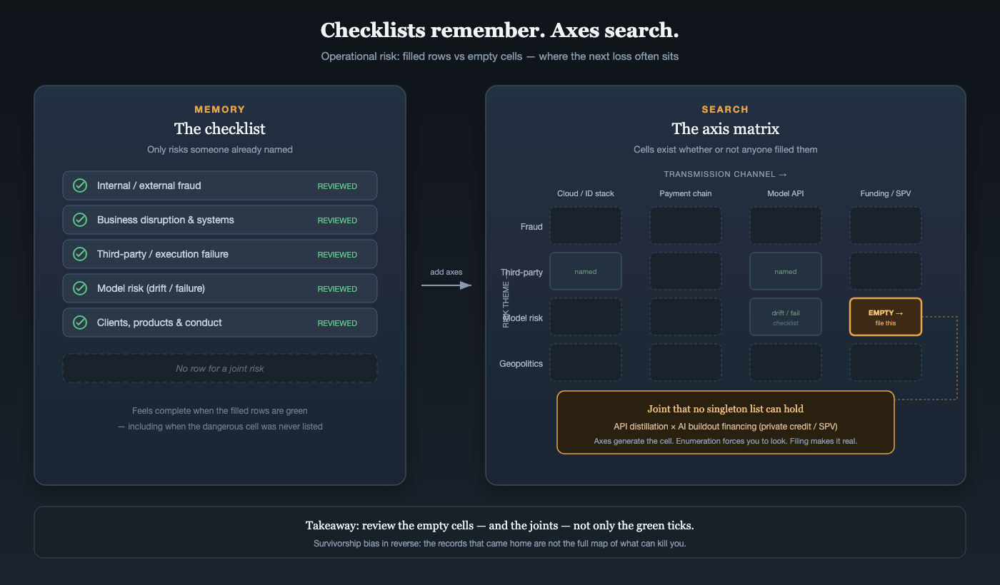

# A Checklist Can Hold Any Risk You Can Name. It Cannot Hold the One You Haven't.

*A fictional scenario exercise for banking operational risk turns a filing problem into an argument: a checklist cannot expose a joint risk for which it has no row.*

The most dangerous feature of an operational-risk checklist is not a missing row. It is the shape of the list — because the shape decides which questions never get asked. A list can only return risks that somebody, somewhere, has already named — Basel's taxonomy names seven top-level event types,[^1] while an industry reference taxonomy offers a broader set.[^2] Neither representation guarantees that a coupled risk will be visible.

## Lists Remember. Enumeration Searches.

*Figure. **Checklists remember; axes search.** Left: operational-risk memory as named rows that can all be “reviewed” while a joint still has nowhere to live. Right: risk themes × transmission channels generate empty cells by construction; the amber cell is a joint (API distillation × AI buildout financing) no singleton checklist can hold. Enumeration forces the look; filing makes it real. Same sampling logic as wartime survivorship bias: the records that return are not a full map of what can kill you.*

Checklists dominate operational risk for a good reason — they are how an institution remembers. Every row exists because something happened, to someone, expensively. I am not against memory.

But memory has a shape, and the shape does work you don't see. A list presents only filled cells; there is no visible slot for the risk nobody has written down, so reviewing a list feels complete precisely when it isn't. That false completeness is not a user error. It is a property of the representation.

There is a cleaner way to see the same error, from a different war. During the Second World War, the US Statistical Research Group — mathematicians working the war as equations, not as slogans — was given data on where returning aircraft had been hit by enemy fire. The hits clustered on fuselage and other surfaces; engines showed fewer holes. A natural impulse is to armor where the damage is densest. The insight associated with Abraham Wald runs the other way: the sample is the planes that came home. The missing holes are not missing because those parts were never hit. They are missing because the aircraft hit there often did not return.[^3] Survivorship bias is not a trivia fact about bullet patterns. It is a filing discipline: the records you can review are not the records of what kills you.

Operational-risk checklists have the same sampling problem. They are maps of losses that became rows — the survivors of institutional attention. The loss that never found a vocabulary, or that arrived only as a joint no single line could hold, does not show up as a dense cluster of "hits" on last quarter's register. A taxonomy built from axes — risk categories crossed with external drivers crossed with transmission channels — behaves differently. It generates cells whether or not anyone has filled them, and an enumeration over those axes forces you to look at combinations no one proposed. It is not a perfect substitute for the planes that never landed. It is a deliberate attempt to stare at the empty panels.

Think of the difference as recall versus search. A checklist is a memory aid: it asks whether the known failure modes still have owners, controls, and residual ratings. An enumeration is a search procedure: it asks what the joint space of categories, drivers, and channels contains — including cells that have never been populated. Institutions prepare for risks one at a time; damaging failures are often combinations — a control weakness, a concentrated dependency, and an external shock in the same window. A deliberately small nine-risk fictional fixture already has 511 non-empty subsets. No workshop should review all of them, but a search procedure can make the space and its pruning rules explicit.

I am not arguing that workshops are obsolete. I am arguing that they inherit the same vocabulary constraint as the checklist: experts can only deliberate on combinations they can name. If the joint is invisible to the taxonomy, it is invisible to the room.

## What the Project Refuses to Skip

Contingency Atlas is an independent research project that explores that problem with public sources, synthetic examples, and a small versioned taxonomy. Banking is a demanding test domain because coupled operational failures are consequential and unusually difficult to enumerate.

The mechanics matter less than the discipline, which comes down to four rules:

1. Cited public signals enter the register only after a human reviewer attests source and rights for every record.
2. Language models draft prose; they never write a number.
3. A deterministic engine joins approved risks into compound scenarios along shared transmission channels (same identity stack, same cloud region, same payment chain, same funding model) and scores each pairing with an uncertainty interval rather than a point estimate.
4. A compound graduates into the scenario library only if its members actually co-fired in a holdout quarter. In-sample coincidences stay out.

Those rules are deliberately unglamorous. They exist because the critical failure mode is a polished narrative that cannot be challenged. If a model invents a severity number, evidence and prose become indistinguishable. If a compound graduates on in-sample coincidence alone, the result is a storytelling engine rather than a scenario library. The holdout gate keeps an attractive ranking from becoming its own justification.

The ranking engine is documented in a technical white paper in the project repository: standard frequency × severity per risk atom, dependence estimated with an explicit shrinkage prior, Monte Carlo propagation, and a tail overlay that must pass its own stability test or be discarded — plus pre-registered evaluation with failures published next to passes.[^6] What matters is not exotic mathematics; it is the refusal to let fluency substitute for a reconstructible number.

The scoring math is only part of the problem. The filing discipline is the harder constraint.

## A Fictional Filing Exercise

Consider a deliberately fictional fixture: a cited public signal describes pressure to reproduce a model's capability through repeated API queries, while a separate synthetic signal describes concentrated financing of the infrastructure on which that capability depends. Neither record represents a real institution, and no score or ranking below is copied from an operator store.

The first signal could be filed as model risk, third-party dependency, geopolitical exposure, or legal uncertainty. A model-risk checklist centered on drift, validation, and change control may never ask whether capability can be reproduced from outputs. Crossing risk themes with transmission channels makes the missing cell visible without pretending that its contents are already proven.

The joint is the argument: capability extraction pressure and concentrated financing can share a technology and funding stack even though they occupy different checklist rows. Enumeration proposes the pairing; public evidence and human review must decide whether it survives. No runtime rank or probability is needed to establish the structural gap.

If you lend into the build, finance the SPV chain, or depend on model APIs as production infrastructure, the joint is not abstract. The transmission channel is shared: the same capability stack that creates competitive edge is also the stack that can be extracted, financed, and concentrated. A singleton checklist can hold "third-party model provider" and "data-center credit exposure" as separate lines and still never force the question of what happens when extraction pressure and financing migration move together.

## What the Numbers Are Not

Every output of this system is a hypothesis for challenge, not a prediction — scores express model assumptions, not calibrated probabilities. A synthetic regime with planted truth can test whether the machinery recovers known structure; it cannot establish facts about the world. One disclosed limitation is that the current estimator can under-price rare, never-observed combinations. A proposed fix is adopted only if it wins a pre-registered test.

The useful result is not a particular p̂. It is the filing, the vocabulary gap, and the joint that an inherited list would not have scheduled for review. Enumeration creates the obligation to examine combinations that were not already named.

## Why This Matters Beyond One Project

Operational risk programs are good at institutional memory and bad at institutional search. That is not a moral failing. Memory is what supervisors, auditors, and capital models know how to consume. Search is messier: it produces empty cells, contested filings, and pairs that look speculative until the week's news makes them concrete.

The industry is already feeling pressure at the edges of the taxonomy. Model risk is increasingly named; third-party and ICT concentration are increasingly stressed; AI infrastructure financing is migrating into structures that blur traditional silos. What is still rare is a standing practice that systematically generates the joints between those themes and demands a human decision on each empty cell — keep, kill, or escalate.

No software is required to start that practice. One inexpensive institutional method already exists, with a clean provenance: the **pre-mortem**, formalized by psychologist Gary Klein and set out in a 2007 *Harvard Business Review* note, on top of older work on "prospective hindsight."[^4][^5] A post-mortem asks what went wrong after the damage. A pre-mortem asks the team to stand in a near future where the initiative has already failed — not "what might go wrong," but "it failed; write down why" — and then work backward while there is still time to change the plan.

Done properly, it is not a vibe check. It is a short, forced search of empty cells:

1. **When** — early enough that redesign is still cheap; ideally at kickoff or before a major control decision locks, not after the steering committee has fallen in love with the slide.
2. **What** — name the failure in the past tense ("the distillation joint wiped a book / the compound scenario was never escalated / the model API dependency and the SPV financing chain moved together and we had no owner").
3. **How / why** — each participant independently lists plausible causes; then share. The point is to authorize dissent that polite planning suppresses.
4. **Remediate in advance** — for the causes that survive scrutiny, assign an owner, a control, a monitoring signal, or an explicit accept — before launch, not in the lessons-learned deck.
5. **Iterate** — re-run when the taxonomy, the product, or the threat surface changes. A pre-mortem that is never revisited becomes another checklist.

A pre-mortem will not enumerate 511 combinations. It will not score dependence intervals. What it will do is fight the same false completeness that armored the fuselage: it makes people look at the planes that did not come back *before* they are missing.

The project is intentionally small: public sources, human attestation, no model-invented numbers, deterministic joins, and holdout graduation. It is a research test bed for a question enterprise frameworks have not finished asking: if the next material loss is a combination, how can combinations become visible before they are historical?

The list you inherit holds the last generation's losses, and it earns its keep. The next material loss is more likely sitting in a cell nobody has filed yet — plausibly as a pairing no list can hold. Pick one empty cell this quarter and try to fill it with something real — or run a one-hour pre-mortem that assumes the empty cell already killed the plan. Either attempt will teach you more about your risk vocabulary than a hundred reviews of the filled ones.

---

## Notes

[^1]: Basel Committee on Banking Supervision, operational-risk event-type categories under the Basel framework (seven Level-1 event types: internal fraud; external fraud; employment practices and workplace safety; clients, products and business practices; damage to physical assets; business disruption and system failures; execution, delivery and process management). See e.g. BCBS materials on operational risk and loss-event classification; retained as Level 1 in later European reporting taxonomies.

[^2]: Operational Riskdata eXchange Association (ORX), *Event Type Operational Risk Reference Taxonomy* (industry reference taxonomy; commonly described as expanding Basel-style event types into a broader Level-1 set of sixteen categories). Member implementations vary; "about fourteen" is an industry rule-of-thumb, not a regulatory constant. See [ORX Event Type Operational Risk Reference Taxonomy](https://orx.org/resource/event-type-operational-risk-reference-taxonomy).

[^3]: Abraham Wald's wartime work with the US Statistical Research Group (SRG) on aircraft vulnerability and the logic of **survivorship bias**: damage observed on *returning* aircraft is a selected sample; areas with few observed hits on survivors can be the lethal ones (the "missing bullet holes" are on the missing planes). Accessible account: Jordan Ellenberg, *How Not to Be Wrong: The Power of Mathematical Thinking* (Penguin Press, 2014), chapter material on Wald and the missing bullet holes; see also American Mathematical Society feature coverage of Wald and the SRG. Popular retellings simplify operational detail; the sampling insight is the load-bearing claim.

[^4]: Gary Klein, ["Performing a Project Premortem,"](https://hbr.org/2007/09/performing-a-project-premortem) *Harvard Business Review* (September 2007). Team assumes the project has already failed and generates reasons in the past tense, then mitigates while redesign is still cheap.

[^5]: Deborah J. Mitchell, J. Edward Russo, and Nancy Pennington, "Back to the Future: Temporal Perspective in the Explanation of Events," *Journal of Behavioral Decision Making* 2, no. 1 (1989): 25–38 — "prospective hindsight," the cognitive basis Klein builds on.

[^6]: Nicolas Cravino, *Rating Compound Operational-Risk Scenarios: A Deterministic Scoring Algorithm with Pre-Registered Falsification*, Contingency Atlas white paper, scoring engine `algorithm_version` 0.1.0, paper revision 2 (3 August 2026). Specifies the deterministic layer stack, auditability contract, synthetic-regime results, and disclosed estimator defects. Companion sources in the public repo: [WHITEPAPER_v2.md](https://github.com/sw30labs/contingency-atlas/blob/main/docs/research/whitepaper/WHITEPAPER_v2.md), manuscript PDF under `docs/research/whitepaper/manuscript/`, and [algorithm-spec.md](https://github.com/sw30labs/contingency-atlas/blob/main/docs/research/redesignv1/algorithm-spec.md). Repository: [github.com/sw30labs/contingency-atlas](https://github.com/sw30labs/contingency-atlas). Research-tier outputs only — not capital parameters or risk advice; see the project's `DISCLAIMER.md`.
